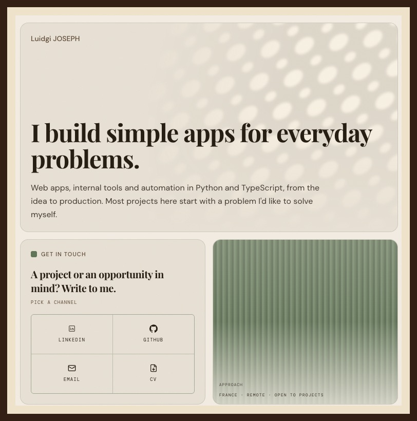
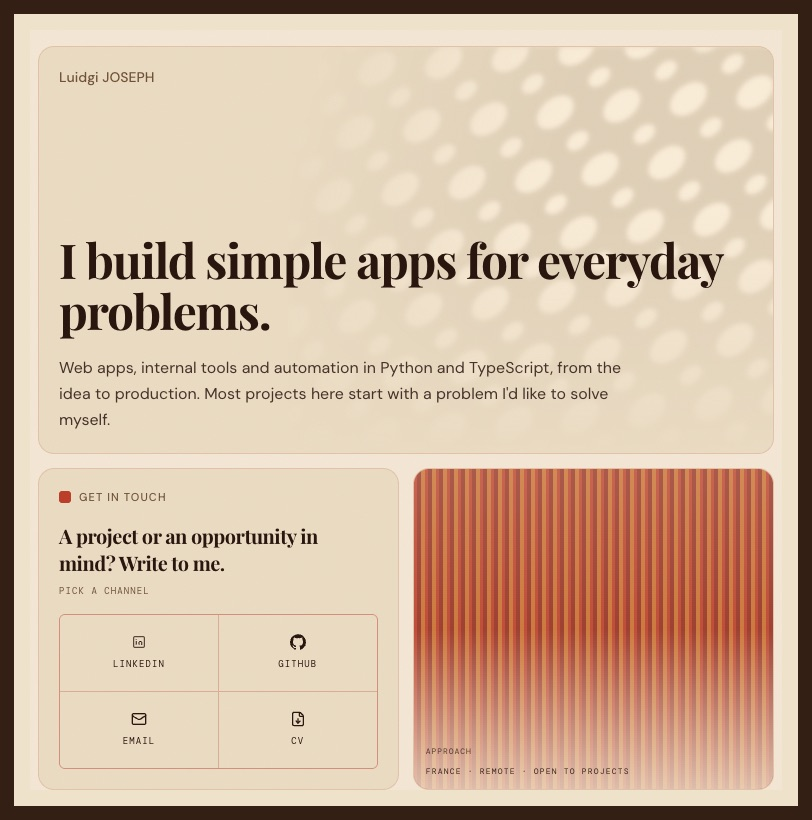
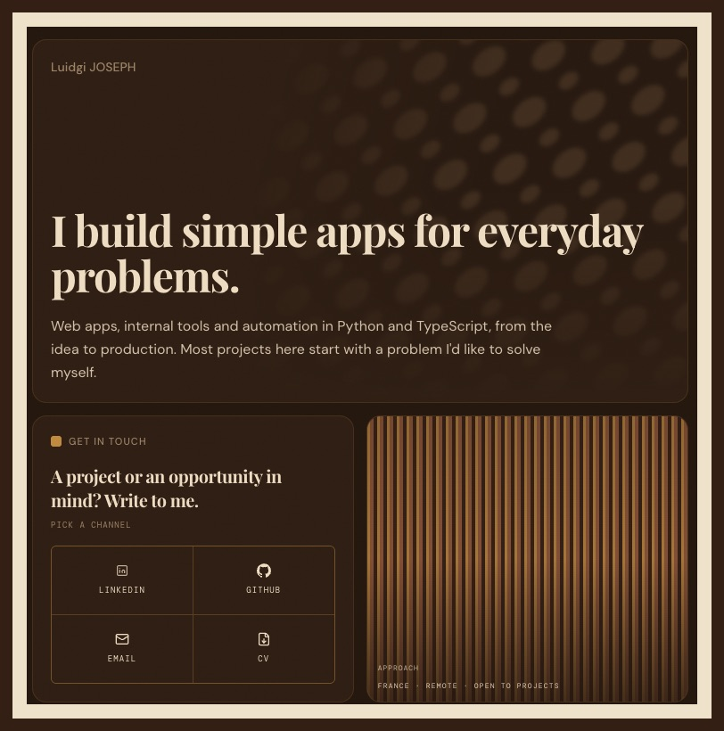
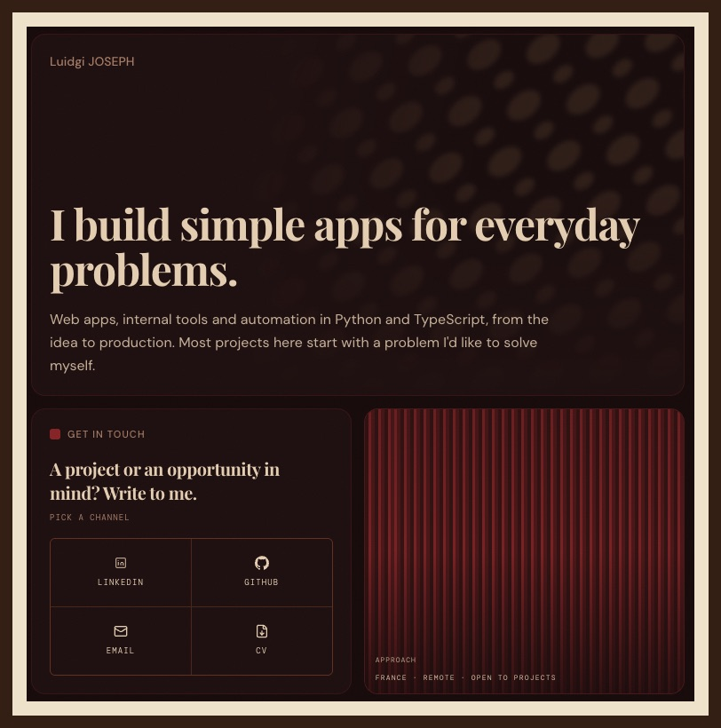
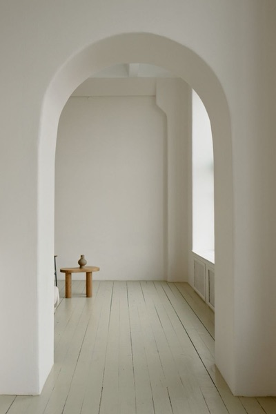
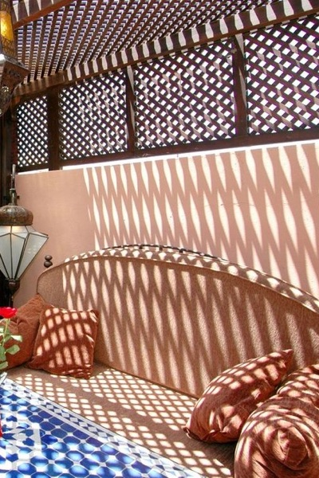
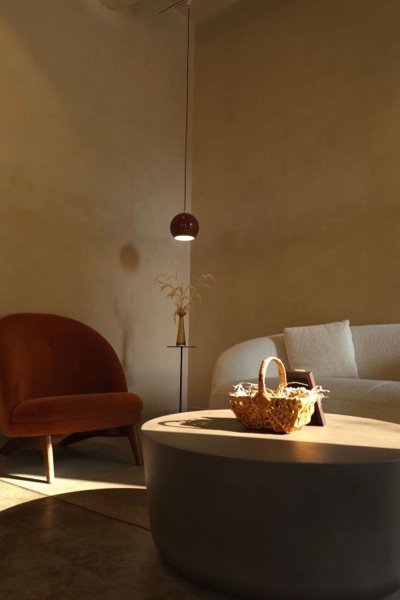
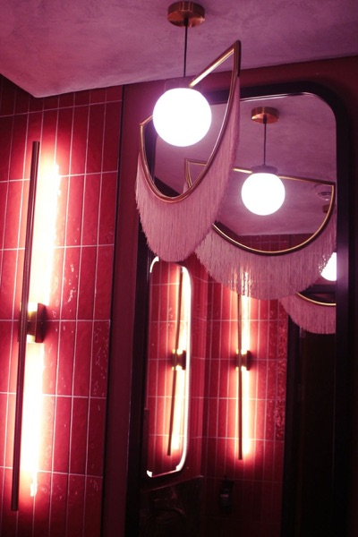

# web-portfolio

My personal site: a single bento page that presents my work as a software engineer,
in English and French. Each project card opens a full screen case study.

The look comes from Mid-Century Modern interiors of the 1950s to the 1970s: teak,
cognac leather, brass, plaster, breeze blocks and Bauhaus posters. The visitor picks one
of four rooms, and the whole site takes its colors. Amber Chocolate is the default.

<table>
  <tr>
    <td></td>
    <td></td>
    <td></td>
    <td></td>
  </tr>
  <tr>
    <td align="center"><sub>01 · White Plaster</sub></td>
    <td align="center"><sub>02 · Terracotta Sand</sub></td>
    <td align="center"><sub>03 · Amber Chocolate</sub></td>
    <td align="center"><sub>04 · Oxblood Night</sub></td>
  </tr>
</table>

## What's on the page

A bento homepage and three case studies, each in a full screen modal: **Strive**, the
habit tracker I build and run alone, **this portfolio**, and my **professional work** at
Voltaire Group. Error pages are drawn as a Bauhaus exhibition poster.

## Design

Full spec: [`design/design-system.md`](design/design-system.md).

### Four rooms

Each ambiance is a CSS class on `<html>` that redefines the same tokens, and each one
starts from a photo of a real room.

<table>
  <tr>
    <td></td>
    <td></td>
    <td></td>
    <td></td>
  </tr>
  <tr>
    <td align="center"><sub>01 · <code>#6B8060</code> sage</sub></td>
    <td align="center"><sub>02 · <code>#C4472A</code> terracotta</sub></td>
    <td align="center"><sub>03 · <code>#C8963E</code> brass</sub></td>
    <td align="center"><sub>04 · <code>#922828</code> oxblood</sub></td>
  </tr>
</table>

<sub>Photos from Pexels by Ksenia Chernaya, Moussa Idrissi, B.M Shah-e-mulk and Tiffany
Christie Freeman. Sources in
[`design/portfolio-case-study-images.md`](design/portfolio-case-study-images.md).</sub>

### Decoration comes from real objects

- **Breeze block sunlight** in the hero, like low sun through a 1950s concrete screen.
- **Bauhaus art** and the **error poster**, built from half discs, bars and a rule.
- **Paint sample chips** as the label of every clickable card.
- **A framed print** for the case study modal, after the Case Study House program.
- **Teak, leather and brass** in CSS, under a film grain.

Type: Playfair Display for headings, DM Sans for text, DM Mono for labels.

### Avoiding the generated look

Halfway through, the site looked generated in one click. An audit (LUI-178) removed
the hero glow, the abstract arcs and radar ornaments, the `//` labels and the widely
tracked caps, then rewrote the copy in a plainer voice. The rules that came out of it
live in the design system and in [`docs/voice-tone-guidelines.md`](docs/voice-tone-guidelines.md).
The main one: Playfair, a bento grid and grain are now a generated look of their own, so
the materials have to carry the identity.

### Method

References go in [`design/inspirations/`](design/inspirations/), then two to four
directions are compared side by side in an HTML mockup in
[`design/mockups/`](design/mockups/). Only the winner gets built.

| Mockup                                                            | Kept             |
| ----------------------------------------------------------------- | ---------------- |
| [`modal-directions.html`](design/mockups/modal-directions.html)   | Case Study House |
| [`case-study-blocks.html`](design/mockups/case-study-blocks.html) | design guide     |
| [`error-pages.html`](design/mockups/error-pages.html)             | Bauhaus poster   |
| [`professional-work.html`](design/mockups/professional-work.html) | hairlines        |

## Repository layout

The Next.js app lives in a subfolder, so the root holds the design and docs work next
to it.

```
web-portfolio/            # git repo root
├── web-portfolio/        # the Next.js app, package.json lives here
├── design/               # design system, inspirations, moodboards, HTML mockups
├── docs/                 # voice and tone guide, TIL log
└── .github/workflows/    # CI: lint, typecheck, tests
```

Install, run and test from `web-portfolio/`: see
[`web-portfolio/README.md`](web-portfolio/README.md).

## Deployment

Deployed on [Vercel](https://vercel.com). Because the app is nested, three project
settings must be set explicitly:

| Setting           | Value           |
| ----------------- | --------------- |
| Framework Preset  | `Next.js`       |
| Root Directory    | `web-portfolio` |
| Production Branch | `main`          |

Setup and deployment gotchas are logged in [`docs/TIL.md`](docs/TIL.md).
