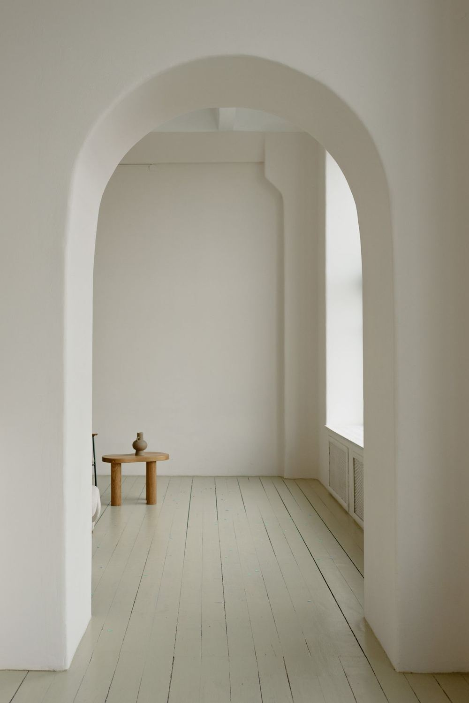
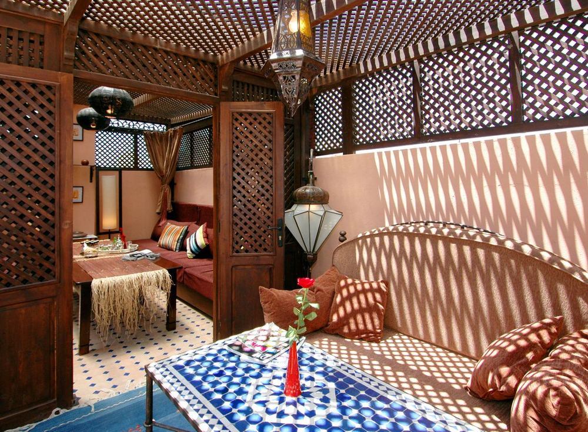
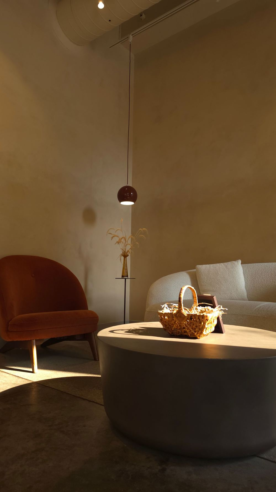

# web-portfolio

My personal site: a single bento page that presents my work as a software engineer,
in English and French. Each project card opens a full screen case study.

The look comes from Mid-Century Modern interiors of the 1950s to the 1970s: teak,
cognac leather, brass, plaster, breeze blocks and Bauhaus posters. The visitor picks one
of four rooms, and the whole site takes its colors. Amber Chocolate is the default.

<table>
  <tr>
    <td></td>
    <td></td>
    <td></td>
    <td></td>
  </tr>
  <tr>
    <td align="center"><sub>01 · White Plaster</sub></td>
    <td align="center"><sub>02 · Terracotta Sand</sub></td>
    <td align="center"><sub>03 · Amber Chocolate</sub></td>
    <td align="center"><sub>04 · Oxblood Night</sub></td>
  </tr>
</table>

## What's on the page

- **Homepage**: hero, about, stack, contact, language switch and the ambiance picker, laid
  out as a bento grid.
- **Three case studies**, each in a full screen modal with chapters as tabs:
  - **Strive**, a habit tracker I built and run alone (Next.js, Supabase), live in two
    languages.
  - **This portfolio**, with a Design chapter that shows the references, the directions
    I dropped and why.
  - **Professional work** at Voltaire Group: the projects, the method, the figures and
    what I took from it.
- Localized 404 and error pages, drawn as a Bauhaus exhibition poster.

## Design

The full spec lives in [`design/design-system.md`](design/design-system.md). This is the
short version.

### Four rooms, one set of components

Each ambiance is a CSS class on `<html>` (`.theme-01` to `.theme-04`) that redefines the
same tokens. Components never know which room they are in.

| Ambiance             | Background | Primary              | Taken from                                |
| -------------------- | ---------- | -------------------- | ----------------------------------------- |
| 01 · White Plaster   | `#F4EFE6`  | `#6B8060` sage       | a white plaster arch in an empty room     |
| 02 · Terracotta Sand | `#F5EAD8`  | `#C4472A` terracotta | a Moroccan room with terracotta walls     |
| 03 · Amber Chocolate | `#271608`  | `#C8963E` brass      | an MCM living room under a pendant lamp   |
| 04 · Oxblood Night   | `#160606`  | `#922828` oxblood    | a burgundy tiled bathroom with aged brass |

<table>
  <tr>
    <td></td>
    <td></td>
    <td></td>
    <td></td>
  </tr>
  <tr>
    <td align="center"><sub>Ksenia Chernaya</sub></td>
    <td align="center"><sub>Moussa Idrissi</sub></td>
    <td align="center"><sub>B.M Shah-e-mulk</sub></td>
    <td align="center"><sub>Tiffany Christie Freeman</sub></td>
  </tr>
</table>

<sub>Reference photos from Pexels, credits and sources in
[`design/portfolio-case-study-images.md`](design/portfolio-case-study-images.md).</sub>

### Type

- **Playfair Display** for headings, set plain: no italic or colored word to stress a
  headline.
- **DM Sans** for body text, with a loose line height.
- **DM Mono** for labels, chips and metadata, in caps with light tracking (`0.12em`).
- **Sora** only inside the Strive card and case study, as Strive's own typeface.

### Decoration comes from real objects

Every ornament on the site points to a photo in [`design/inspirations/`](design/inspirations/):

- **Breeze block sunlight** in the hero: afternoon sun crossing a perforated concrete
  screen, skewed like low light on a wall. Hero only, because a room has one sun.
- **Bauhaus art** made of half discs, bars and a dividing rule, after Bauhaus posters and
  Alexander Girard.
- **Error poster**: the 404 and 500 codes drawn with the same shapes, one colorway per
  code, like a poster series.
- **Paint sample chips**: the small color square that labels every clickable card.
- **A framed print** for the case study modal, after the Case Study House program in
  _Arts & Architecture_: a hairline mat inset in the frame is its only ornament.
- **Materials** in CSS: teak grain, aged leather, brass gradients, and a film grain over
  the page.

### Avoiding the generated look

Halfway through, the site read as if it had been generated in one click, even though it
avoided the usual suspects (SaaS blue, purple gradients, Space Grotesk). An audit
(LUI-178) found that the tells were patterns, so the fixes are patterns too:

- Removed: the glow behind the hero, concentric arcs, a radar ornament, a botanical
  stem, the arcs in the modal, `//` code-comment labels and widely tracked caps.
- One recipe per element reads as a template, so card labels have two treatments by
  role: a title block on static cards, a paint chip on clickable ones.
- A reference is borrowed only if it reads without its caption.
- One atmosphere effect per surface: grain on the page, a lamp glow in the modal,
  nothing behind the cards.
- Playfair, DM Sans, a bento grid and grain are now a generated look of their own. The
  MCM materials have to carry the identity.
- The copy follows the same audit: no slogan headings, no "Let's" call to action, no
  triad of abstract nouns, real facts instead of qualities. French is written natively.
  See [`docs/voice-tone-guidelines.md`](docs/voice-tone-guidelines.md).

### How a design decision gets made

1. Collect references in [`design/inspirations/`](design/inspirations/) and the four
   [`design/moodboards/`](design/moodboards/).
2. Put two to four directions side by side in a standalone HTML mockup in
   [`design/mockups/`](design/mockups/). Mockups load the real tokens, so they switch
   ambiance like the site.
3. Build only the winner, then record the decision in `design-system.md`.

| Mockup                                                            | Compared                                         | Kept                          |
| ----------------------------------------------------------------- | ------------------------------------------------ | ----------------------------- |
| [`modal-directions.html`](design/mockups/modal-directions.html)   | Nelson sideboard, Case Study House, brass mirror | Case Study House              |
| [`case-study-blocks.html`](design/mockups/case-study-blocks.html) | tiles, drawing set, design guide                 | design guide                  |
| [`error-pages.html`](design/mockups/error-pages.html)             | Bauhaus poster, missing tile                     | Bauhaus poster                |
| [`professional-work.html`](design/mockups/professional-work.html) | hairlines, stamped, brass plaque                 | hairlines, saddle stitch flow |

## Repository layout

The Next.js app lives in a subfolder, so the root holds the design and docs work next
to it.

```
web-portfolio/            # git repo root
├── web-portfolio/        # the Next.js app, package.json lives here
├── design/               # design system, inspirations, moodboards, HTML mockups
├── docs/                 # voice and tone guide, TIL log
└── .github/workflows/    # CI: lint, typecheck, tests
```

Install, run and test from `web-portfolio/`: see
[`web-portfolio/README.md`](web-portfolio/README.md).

## Deployment

Deployed on [Vercel](https://vercel.com). Because the app is nested, three project
settings must be set explicitly:

| Setting           | Value           |
| ----------------- | --------------- |
| Framework Preset  | `Next.js`       |
| Root Directory    | `web-portfolio` |
| Production Branch | `main`          |

Setup and deployment gotchas are logged in [`docs/TIL.md`](docs/TIL.md).
